# X-Ray

Agentic memory substrate for local and Kubernetes-native use.

X-Ray gives an agent two kinds of memory:

- **Authored memory.** Typed items that agents and people write: facts, patterns, events, notes. In a cluster each item is a `MemoryCell` custom resource (`xray.triageagent.dev/v1`); in a program they live in the process.
- **Derived memory.** A graph of source code, documentation and Kubernetes manifests, built from files that already exist and searched by meaning: who calls this, what breaks if it changes, where was it decided.

Both are searched by keyword and by meaning, and a web UI that is part of the binary draws the memory and lights it up as agents recall. You can run X-Ray as a service on Kubernetes, embed it in your own agent as a Go library, or connect an agent to a running one over MCP.

[Specification](docs/spec.html) · [Adding X-Ray to an agent](docs/sdk.md) · [Architecture decisions](docs/adr/README.md) · [Changelog](CHANGELOG.md)

| You want | Use | Section |
|---|---|---|
| A shared memory service for your agents and your team | the Helm chart | [Run it on Kubernetes](#run-it-on-kubernetes) |
| Memory and a code graph inside one agent, no server | `pkg/memory`, `pkg/codegraph` | [Build an agent with X-Ray embedded](#build-an-agent-with-x-ray-embedded) |
| An agent that uses an X-Ray that is already running | `pkg/xray`, or any MCP client | [Connect an agent to X-Ray](#connect-an-agent-to-x-ray) |

## What it does

- **Typed memory.** Every item has a `kind` (`stable_fact`, `event`, `note`, `system_identity`, `operational_pattern`, `active_concern`, `watch_item`, `hypothesis`, `recent_change`, `unknown`), a `scope` (`public` or `private`), a subject, tags, a confidence, typed links and an optional expiry.
- **Recall.** Search fuses keyword and semantic ranking, collapses near-duplicate facts and weighs query words by how distinctive they are. With an embedding endpoint it builds an HNSW index; without one it falls back to keyword search.
- **Provenance.** Every item records who wrote it. A write that names a person is `human`, anything else `derived`, and a model's write never replaces a person's. A wrong item is refuted, and the items drawn from it are retired with it.
- **Code graph.** Go and ten other languages, Markdown and YAML become one graph per repository, with resolved call and import edges. It serves `search_graph`, `get_graph_node`, `get_graph_impact` and `get_graph_risk`, and snapshots can be age-encrypted. See [docs/graph.md](docs/graph.md).
- **Web UI.** Embedded in the binary and served at `/`: the memory graph, search, per-kind lists, voice, and a live view of recalls. It runs the same locally and in a cluster.
- **Interfaces.** MCP, a REST API, a server-sent event stream, a Gemini Live voice WebSocket, and the Go packages below.
- **Access control.** GitHub or Microsoft Entra sign-in, an optional GitHub org and team restriction, and OAuth 2.1 for MCP clients with read and write scopes.

## How a recall shows up

<p align="center"></p>

Every recall is an event. When an agent recalls memory, through `search_memory` or `get_memory_context` over MCP, or by voice, the store publishes a **hit** event: the ids of the items it returned, the query, and the kind of each item. A write publishes a **change** event. Both reach every connected client over a live stream. This server streams them as server-sent events at `/v1/memory/events`, and the web UI in the binary listens to that stream. A deployment that carries the same events over a WebSocket, as a Triage controller does, drives the same UI. Private items are never named on the stream.

The web UI turns a hit into light, the way optogenetics does: a neuron made to carry a light-gated channel fires when blue light reaches it. In the graph:

1. **The region.** The kinds in the event name the region, so a blue fibre lights it even when the recalled cell is not one of the nodes drawn.
2. **The cells in it** wash blue in the order the light reaches them, nearest the fibre first.
3. **The recalled cells** fire hardest: a white-blue double flare, three spike rings, and an afterglow that lasts a few seconds.
4. **The synapses.** A pulse of light runs from each recalled cell along its links to the memories it connects to.

This sits on top of the category-coloured flash the graph already draws, and a repeat hit fires again. The region treatment is one fast attack and a smooth decay, about two pulses a second at most, because flicker over a large area is a photosensitivity risk; the fast effects stay on the small dots, and `prefers-reduced-motion` gets one slow wash.

### Base components

| Component | Does what here |
|---|---|
| **HNSW** | Approximate nearest-neighbour search over embeddings. Memory builds one index per subject over its cells, so a restart rebuilds from the cells without re-embedding. Each code-graph map carries its own index inside the snapshot, so loading a map is not an embed pass. |
| **Tree-sitter** | The parser behind the code graph. Go gets resolved call, import and inherit edges; TypeScript, JavaScript, Python, Java, Rust, Ruby, C, C++, PHP, C#, Kotlin and Swift go through a generic extractor. The grammars are C and link into the CGO build, which is why only that build parses. |
| **Kubernetes** | `MemoryCell` custom resources are the store; etcd persists, replicates and audits them. |
| **MCP** | The agent interface to both kinds of memory, over streamable HTTP, with OAuth 2.1 or a shared secret. |

## Run it on Kubernetes

The chart runs the `xray` server: REST, MCP and voice, with memory stored as `MemoryCell` objects and a local embedding sidecar for semantic search. It needs Kubernetes 1.29 or later (the sidecar is a native sidecar), Helm 3, and a namespace of its own: the server reads Secrets in its namespace.

The images and charts are published to GitHub Packages:

| | |
|---|---|
| Image | `ghcr.io/triageagent-dev/xray:<version>` (the build with the parser is `:<version>-parser`) |
| Chart | `oci://ghcr.io/triageagent-dev/charts/xray` |

### A first look

Sign-in off, reached through `kubectl port-forward`. Use it for a trial only.

```bash
kubectl create namespace xray
kubectl -n xray create secret generic xray-mcp-token --from-literal=token="$(openssl rand -hex 24)"

helm upgrade --install xray oci://ghcr.io/triageagent-dev/charts/xray \
  --version <version> -n xray --set dev=true

kubectl -n xray rollout status deploy/xray
kubectl -n xray port-forward svc/xray 8080:80 8083:8083 &
curl localhost:8080/v1/version
```

Open http://localhost:8080 for the web UI.

`dev=true` adds `--dev`, which turns sign-in off and accepts any origin. MCP is on port 8083 and takes the secret as `Authorization: Bearer <token>`. If the images are in a private registry, create a pull secret in the namespace and add `--set 'imagePullSecrets[0].name=<secret>'`.

The chart installs the `MemoryCell` CRD from its `crds` directory, skipped if the cluster already has it. Helm never upgrades a CRD, so apply a changed one by hand. The embedding sidecar runs in the pod on `localhost:8090`, with the model baked into its image.

### For real use

Without `--dev` the server refuses to start unless it has a sign-in method and the address users reach, and it says which is missing. After creating the namespace and the MCP token as above, set both up:

```bash
kubectl -n xray create secret generic github-oauth \
  --from-literal=GITHUB_CLIENT_ID=<id> --from-literal=GITHUB_CLIENT_SECRET=<secret>
helm show values oci://ghcr.io/triageagent-dev/charts/xray --version <version> > values.yaml
```

Edit `values.yaml`:

- set `github.secretName: github-oauth` (or `azure.secretName` for Microsoft Entra);
- in `args`, uncomment `--public-url=https://xray.example.com` and `--github-org=<your org>`, with your own address and organisation (`--github-team` narrows it to a team);
- set `ingress.enabled: true` with a `hostname`, or use `httpRoute` for a Gateway API route.

```bash
helm upgrade --install xray oci://ghcr.io/triageagent-dev/charts/xray \
  --version <version> -n xray -f values.yaml
```

To give each MCP client a token of its own, which also makes its writes count as `human`, set `mcp.oauth.enabled: true`, uncomment the `--mcp-oauth` lines in `args` and remove `--mcp-address=:8083`. The shared secret still works as a fallback.

**Replicas.** The chart runs one. Items and their change events follow the cluster across replicas, but voice quota counters and search-hit pulses are per pod, so keep `replicaCount: 1`.

**Voice.** Voice runs on Gemini Live. Set `--gcp-project` (Vertex AI, with Workload Identity on a service account that has Vertex AI User) or `--gemini-api-key`. The default model, `gemini-3.8-live`, is served on Vertex only in the multi-regions `eu` and `us`, so add `--voice-location=eu`; `--gcp-location` keeps the embeddings location. A browser needs HTTPS (or localhost) for the microphone.

**A code map from a registry.** Build a map with `xray graph snapshot`, pack it with `make maps-image MAPS="<label>"`, push the image, and give the memory server a cell that points at it by digest. The server pulls the image, registers the map, and answers code questions over MCP and by voice:

```yaml
apiVersion: xray.triageagent.dev/v1
kind: MemoryCell
metadata: {name: map-myrepo}
spec:
  id: map-myrepo
  kind: mental_map
  scope: public
  subject: myrepo            # the map's label
  status: active
  title: myrepo code map
  content: The code graph of myrepo, for questions about how it is built.
  confidence: high
  createdAt: "2026-01-01T00:00:00Z"
  updatedAt: "2026-01-01T00:00:00Z"
  data:
    graphRef: {mime: text/plain, bytes: "ghcr.io/you/maps@sha256:..."}
```

Run the server with `--mental-maps-dir=/tmp/maps` (it may be empty: it turns the map registry on) and, for a private registry, `--registry-pull-secret=<dockerconfigjson secret>`. An age-encrypted snapshot opens with `--mental-maps-snapshot-key`. See [docs/graph.md](docs/graph.md).

**Traces.** `--otel-endpoint=http://collector:4317` sends voice traces over OTLP/gRPC, and `--otel-token-secret=<secret>` sends a bearer token from a Secret with them, for a collector that asks for one.

**Voice, tracing and the rest.** Every flag is listed by `xray -help`, and every chart value, with the optional `args` as comments, is in [`charts/xray/values.yaml`](charts/xray/values.yaml). There is one chart; code maps load into it from a registry, as described above.

## Build an agent with X-Ray embedded

X-Ray is also a Go library. The same memory store and code-graph engine the server runs can live inside your agent's process, with no server, no cluster and no MCP in between. The only network call is to the embedding endpoint you choose.

```bash
go get github.com/triageagent-dev/x-ray/v2
```

### Memory

```go
import (
	"github.com/triageagent-dev/x-ray/v2/pkg/memory"
	"github.com/triageagent-dev/x-ray/v2/pkg/xray"
)

store, err := memory.New(ctx,
	memory.WithEmbeddings("http://localhost:8090", "nomic", 256), // optional: semantic search
	memory.WithFile("agent-memory.json"),                         // optional: survive a restart
)
if err != nil { /* ... */ }
defer store.Close()

store.Upsert(ctx, xray.Write{
	Kind: xray.KindStableFact, Scope: xray.ScopePublic, Confidence: "high",
	Title: "Checkout retries on 503", Content: "Three times, with jitter.",
})
items, _ := store.Search(ctx, "how do payments retry?", xray.WithLimit(5))

// A fact turns out to be wrong: retire it, and everything that cited it.
store.Refute(ctx, items[0].ID, "the spikes predate the cache", nil)
```

This is the store the server uses: typed items, a keyword index, an HNSW index when you give it embeddings, merging of restated facts, recall shaping and provenance. `WithOrigin(xray.OriginHuman)` marks a store that holds what a person told the agent, so a model's write never replaces it. Without `WithEmbeddings`, search is by keyword only. `WithFile` loads the file when the store opens and rewrites it after every change.

### Code graph

```go
import "github.com/triageagent-dev/x-ray/v2/pkg/codegraph"

emb, _ := codegraph.NewEmbeddings(ctx, "http://localhost:8090", "nomic", 256, 8192)
g, err := codegraph.Build(ctx, emb, codegraph.Repo{Label: "myapp", Path: "./myapp"})
if err != nil { /* ... */ }

hits, _ := g.SearchGraph(ctx, "where do we retry payments?", xray.Limit(5))
impact, _ := g.Impact(ctx, []string{hits.Results[0].QN}, 2, 50) // what a change reaches
risk, _ := g.Risk(ctx, hits.Results[0].QN, 0, 0)                // LOW, MEDIUM or HIGH

g.UpdateGraph(ctx, "./myapp/pay/retry.go") // after the agent edits a file
g.Save(ctx, "myapp.graph.gob.gz")          // later: codegraph.Load, with no parsing
```

`Build` parses with Tree-sitter, so it needs a build with `CGO_ENABLED=1` and a C compiler. A build without cgo can still `Load` a snapshot and search it, and `Build` returns `codegraph.ErrNoParser`. `g.Handler()` returns the graph as an MCP `http.Handler`, if the agent should offer it to others.

### Run on either

`*memory.Store` and `*xray.Client` both implement `xray.Memory`, and `*codegraph.Graph` and `*xray.Client` both implement `xray.CodeGraph`. An agent written against those interfaces runs on the in-process store while you develop and against a shared X-Ray in production without a change. `examples/agent` is a complete agent loop that does exactly this: with no `XRAY_URL` it embeds X-Ray, with one it connects.

### Google ADK

`adapters/adk` makes X-Ray the memory service of a Google ADK agent, over either an embedded store or a running server:

```go
store, _ := memory.New(ctx, memory.WithFile("agent-memory.json"))
save, _ := xrayadk.SaveTool(store)

assistant, _ := llmagent.New(llmagent.Config{
	Name: "assistant", Model: llm,
	Tools: []tool.Tool{preloadmemorytool.New(), loadmemorytool.New(), save},
})
r, _ := runner.New(runner.Config{
	AppName: "my-app", Agent: assistant,
	SessionService: sessions, MemoryService: xrayadk.New(store),
})
```

See [docs/sdk.md](docs/sdk.md) for the full walk-through.

## Connect an agent to X-Ray

For an agent that uses an X-Ray you already run, on Kubernetes or on a laptop. Everything X-Ray offers is an MCP tool, so any MCP client works, and the Go SDK, `pkg/xray`, wraps the tools in typed calls.

| What | Where |
|---|---|
| Memory server, shared secret | `http://<host>:8083/mcp`, `Authorization: Bearer <token>` |
| Memory server, OAuth 2.1 | `https://<your address>/mcp`, a token per user |
| Code graph, live | `xray graph serve`, `http://127.0.0.1:8084/mcp` |
| Code graph, snapshots | `xray graph serve-snapshots`, `http://127.0.0.1:8085/mcp` |

From inside the cluster the memory server is `http://xray.xray.svc:8083/mcp`; from outside, port-forward it as above, or put it behind your own ingress with authentication.

```go
c, err := xray.Connect(ctx, "http://localhost:8083/mcp", xray.WithToken(token))
if err != nil { /* ... */ }
defer c.Close()

c.Upsert(ctx, xray.Write{
	Kind: xray.KindOperationalPattern, Scope: xray.ScopePublic,
	Title: "Checkout retries on 503", Content: "Three times, with jitter.",
})
items, _ := c.Search(ctx, "payment retries", xray.WithLimit(5))

hits, _ := c.SearchGraph(ctx, "who handles retries", xray.OnMap("myapp"))
```

A refusal by the server comes back as `*xray.ToolError`, and `xray.IsNotFound` tests for a missing item. The credential decides how a write is classed: an OAuth token that names a person records it as `human`, the shared secret as `derived`. `Call` reaches any tool the typed methods do not cover.

A coding agent such as Claude Code needs no SDK. Register the code graph in `.mcp.json`:

```json
{ "mcpServers": { "xray": { "type": "http", "url": "http://localhost:8084/mcp" } } }
```

and run `xray graph install -dir <repo>` to add skills and a hook that re-indexes the graph as files change.

## Run locally

The memory server and its web UI without a cluster, sign-in off:

```bash
make run          # server and web UI on :8080, auth off (--dev); needs Node 22 to build the UI
open http://localhost:8080
```

Without a kubeconfig the server keeps memory in process only, and items are lost on restart. Add `--embedding-endpoint` (any OpenAI-compatible endpoint) or `--gcp-project` for semantic search.

The code graph for a coding agent. It needs the CGO build and an embeddings endpoint (llama.cpp, Ollama, vLLM or LM Studio; the default is `http://localhost:8090` serving `nomic` at 256 dimensions):

```bash
make graph-build                                   # bin/xray-parser
bin/xray-parser graph serve -repo myapp=/path/to/myapp
```

## Build

```bash
make build        # static binary, bin/xray: the memory server with the web UI, and the read side of the graph
make build UI=0   # the same without the web UI, so no Node is needed
make graph-build  # CGO binary, bin/xray-parser: adds the parsing modes of `xray graph`
make ui-dev       # UI hot reload on :3000 against a running server
make test         # the Go tests; make ui-test for the web UI
make lint
```

Go 1.25 or later, and Node 22 for the web UI. The CGO build needs a C compiler for the Tree-sitter grammars. Images are built with ko, and the release builds the UI first.

## License

[Apache License 2.0](LICENSE). Third-party notices are in [NOTICE](NOTICE).
